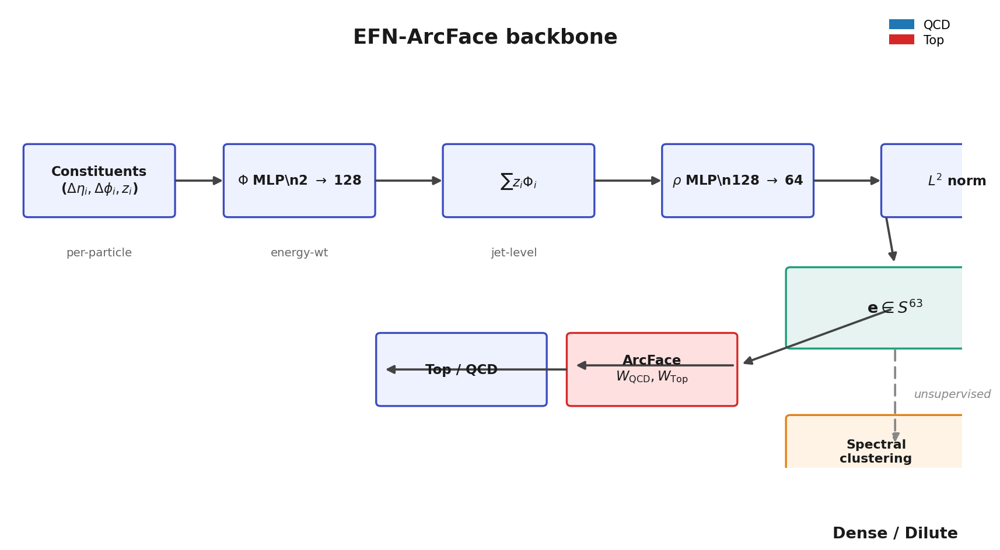

# EFN–ArcFace Top Quark Tagging and Jet Substructure via Hyperspherical Prototypes

[](https://github.com/thirathep-ph/EFN-ArcFace-Top-Quark-Tagging/actions/workflows/ci.yml)
[](https://www.python.org)
[](https://opensource.org/licenses/MIT)



**[🖼️ Results Gallery — all 42 experiment figures with one-line captions](docs/RESULTS.md)**

## Intro

Top-quark vs QCD jet classification is a core LHC task where deep taggers are accurate but opaque. The primary goal of this project is class prototypes: an IRC-safe Energy Flow Network backbone plus an ArcFace head that learns one prototype per class (Top vs QCD), so the binary decision is exactly nearest-prototype on the unit hypersphere S^63. ArcFace was chosen for this reason — to give each class an explicit, inspectable prototype. Diagnostic partition structure (Dense/Dilute × Top/QCD) was a secondary finding en route — uncovered by unsupervised clustering on that manifold and then checked against QCD predictions (splitting functions, angular scaling, Lund topology) using bounded power-law fits instead of being trusted on faith.

## What was done

- **Primary — Tagger (class prototypes)**: EFN Φ [2→128→128→128] + ρ [128→128→64], 59,072 params, ArcFace margin m=0.5, scale s=16, seed 42. Trained on 1.2M jets, tested on 404k (Top Tagging Reference Dataset).
- **Baselines**: EFN+Linear and EFN+CosLinear (3 seeds each) to isolate the effect of the hypersphere vs the margin; random forest on 10 hand-crafted substructure observables.
- **Secondary finding en route — diagnostic partition structure (not the primary goal)**: spectral clustering per predicted class (eigengap selects k=2/class → 4 partitions: Dense/Dilute × Top/QCD), with null controls (noise jets, untrained encoder) and a label-shuffled retraining control. Eigengap gives k=2 on the continuous 2D manifold; Leiden clustering (k-NN graph, γ∈[0.1,10]) finds no resolution yielding k=2, confirming the partition is a diagnostic cut along a continuum.
- **Validation battery**: SoftDrop z_g power-law fits, angular collimation, Lund planes, one mass-matched bin, 3-head geometry comparison (TwoNN/PR/PCA), PySR symbolic distillation, JetNet30 out-of-distribution scan.
- **Verification**: all 122 reported numbers are tracked to artifacts in `experiments/ssot_paper_numbers.json`.

## Results

| Model | Accuracy (404k test) | ROC AUC | Rejection@50%TPR |
|:------|:--------------------:|:-------:|:----------------:|
| EFN + ArcFace (s=16, m=0.5) | **91.84% [91.76, 91.92]** | 0.974 | **124×** |
| EFN + Linear (3-seed mean) | 91.94% ±0.01 | 0.974 | 122× |
| EFN + CosLinear (3-seed mean) | 92.00% ±0.03 | 0.975 | 132× |
| RF (10 substructure features) | 92.37% | 0.977 | 150× |

- **Secondary finding — diagnostic partitions (found en route)**: 4 found, all 4 validated against QCD with bounded DGLAP fits; predicted-vs-truth partitions agree (ARI 0.79). Top-Dense exponent physical under bounded fit (α=−0.41).
- **Splitting exponents** (bounded z_g fits): QCD-Dense −0.45, QCD-Dilute −0.51, Top-Dilute −0.42, Top-Dense −0.41 — ordering matches the QCD soft-singularity hierarchy.
- **Geometry**: embeddings collapse to ~2D (TwoNN 2.21, PCA 83.6+16.4); prototypes 43.6° apart.
- **Distillation**: PySR recovers tanh(m/pT) − 0.348·τ32 — the leading physics only (rejection drops 124→33, stated as-is).

## Discussion

- The random forest wins on accuracy: on this dataset, engineered features beat raw-kinematics EFN. The contribution here is the readable class-prototype representation (one prototype per class on S^63), not SOTA accuracy and not partition discovery.
- Known limits, all stated openly: simulation-only (Pythia 8, no detector effects), binary task, narrow pT window, mass-confounded Dense–Dilute separation, single-seed label shuffle, exploratory p-values. The 2D embedding manifold is continuous; Dense/Dilute is a diagnostic partition, not discrete sub-clusters.

## Conclusion

A 59k-parameter tagger whose decision rule is exactly nearest-class-prototype on a hypersphere — the primary contribution — with diagnostic partition QCD structure as a secondary finding en route (all 4 validated with bounded fits), and every number traceable to tracked artifacts. No result rests on a single p-value or an unchecked claim.

## Reproduce

```bash
python scripts/download_data.py   # ~1.7 GB dataset (Zenodo record 2603256)
pip install -e .
python scripts/train_arcface.py --scale 16 --seed 42 --quick   # sanity run

# Optional speedup: pre-convert H5 -> NumPy (auto on Kaggle, opt-in locally)
# ARCEFN_AUTO_CONVERT=1 python scripts/train_arcface.py --scale 16 --seed 42
# Or manual: python -m scripts.convert_h5_to_npy

# Run on Kaggle (free GPU): see KAGGLE.md
```

Layout: `arcefn/` (models, data, utils, tests), `scripts/` (training, evaluation, `analysis/`), `experiments/*.json` (tracked results), `docs/` (overview figure + full results gallery).

## Citation

```bibtex
@misc{phiankham2026efnarcface,
  author = {Thirathep N. Phiankham},
  title = {EFN--ArcFace Top Quark Tagging and Jet Substructure via Hyperspherical Prototypes},
  year = {2026},
  howpublished = {\url{https://github.com/thirathep-ph/EFN-ArcFace-Top-Quark-Tagging}},
  note = {GitHub research project}
}
```

## License

MIT
